# Nusantara Colossi

**English** · [Bahasa Indonesia](#bahasa-indonesia)

> *Dibuat oleh Ariana Mischa Fadhila dari Syubadubin Studios*
> *Made by Ariana Mischa Fadhila of Syubadubin Studios*

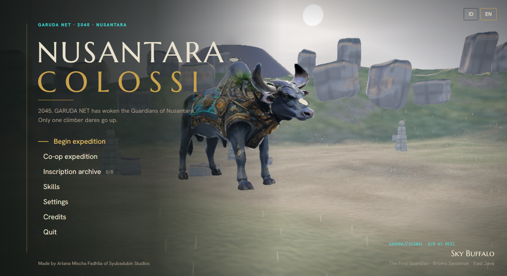

An action-adventure boss hunter set in an alternate Indonesia, 2045. The national AI network **GARUDA NET** has woken eight ancient Guardians across the archipelago. You play **Arka**, a former AI engineer and drone pilot. You climb the Guardians themselves, read the pulse of their cores, and lay them to rest one at a time with your drone, GARUDA.

Built with **.NET 10**, **Avalonia UI** and **Three.Net** (a Rust/wgpu renderer), for **Windows, macOS, Linux and Android**.

| | |
|---|---|
| 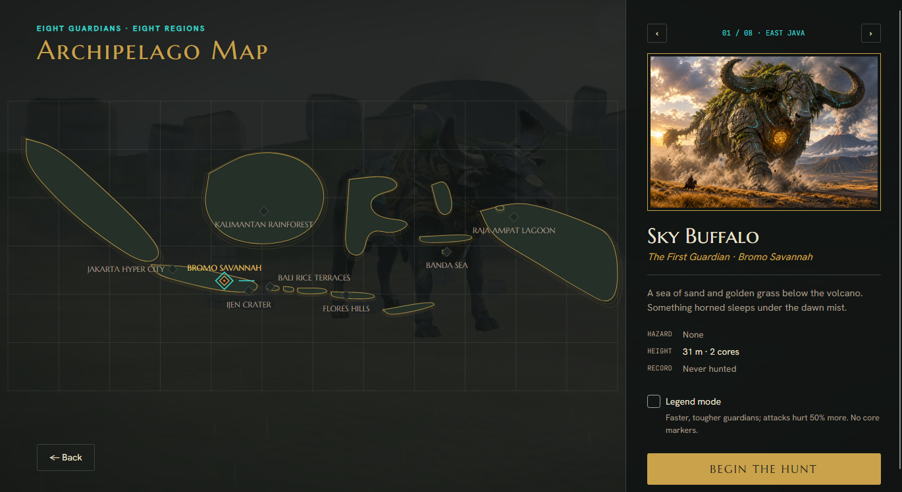 | 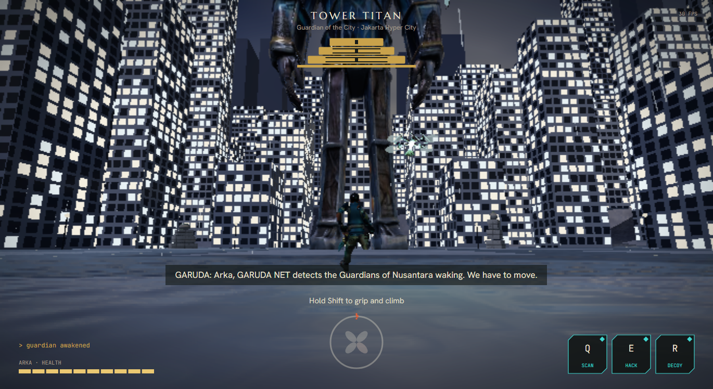 |
| 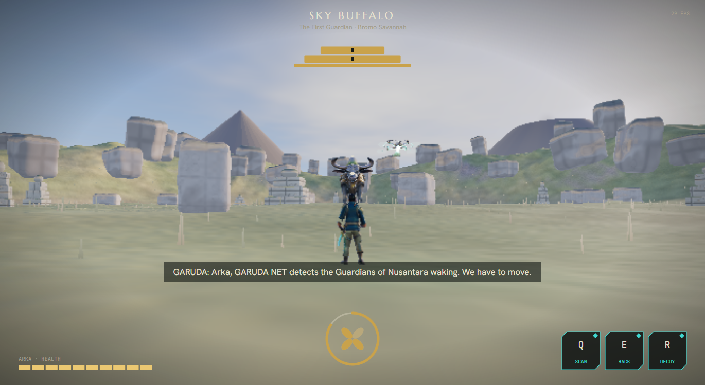 | 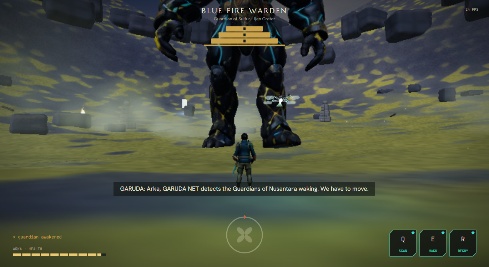 |
| 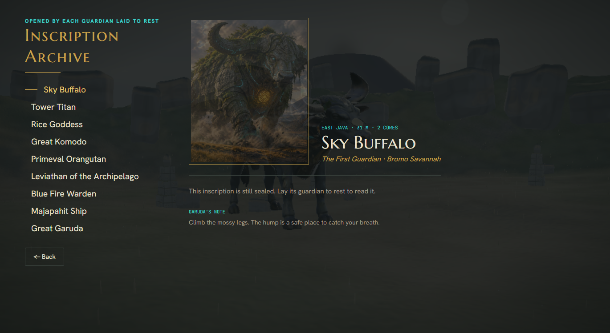 | 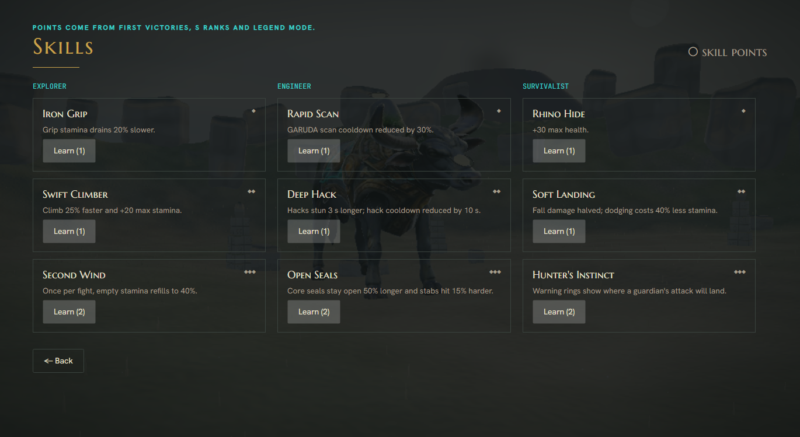 |

## What you do

- **Climb living giants.** Every guardian is an articulated body you can grip, climb, stand on and cross between limbs. Grip stamina drains while you hang. Guardians try to shake you off and warn you just before they do.
- **Read the heartbeat.** Each core beats. Hold the stab, then release it on the pulse for a **resonance** strike that deals ×1.5 damage. The HUD's kawung ring and the audio heartbeat both keep time.
- **Work with GARUDA.** **Scan** to break a core's ancient seal for a few seconds. **Hack** to stun mechanical guardians and open plated cores. **Deploy a hologram decoy** to pull the guardian away. These unlock as you progress.
- **Eight regions, eight guardians**, each with its own hazard:

  | Region | Guardian | Hazard |
  |---|---|---|
  | Bromo | Sky Buffalo | — |
  | Jakarta | Tower Titan | rain on glass |
  | Bali | Rice Goddess | — |
  | Flores | Great Komodo | heat |
  | Kalimantan | Primeval Orangutan | rain |
  | Raja Ampat | Leviathan | — |
  | Ijen | Blue Fire Warden | toxic sulfur gas |
  | Banda Sea | Majapahit Ship | storm gusts |

- **Rage phases, ranks and Legend mode.** Guardians grow faster as they weaken. Each hunt earns an S/A/B/C rank. Legend mode makes guardians faster and stronger and removes the core markers.
- **Light RPG.** Three skill trees (Explorer, Engineer, Survivalist) with three tiers each. You earn points from first victories, S ranks and Legend clears.
- **2–4 player co-op** over LAN or direct IP. The host simulates the guardian, and every hunter climbs with their own local control.
- **Fully bilingual**: Bahasa Indonesia and English, switchable at any time.

## Download

Get the latest build from the **[Releases page](https://github.com/SyubadubinStudios/Nusantara.Colossi/releases/latest)**. Version 0.3.1:

| Platform | File | Notes |
|---|---|---|
| Windows 10/11 (x64) | [Installer (.exe)](https://github.com/SyubadubinStudios/Nusantara.Colossi/releases/download/v0.3.1/NusantaraColossi-0.3.1-win-x64-setup.exe) · [Portable (.zip)](https://github.com/SyubadubinStudios/Nusantara.Colossi/releases/download/v0.3.1/NusantaraColossi-0.3.1-win-x64.zip) | Tested. The installer is not code-signed, so SmartScreen may warn: choose **More info → Run anyway**. |
| macOS (Apple Silicon) | [macos-arm64.zip](https://github.com/SyubadubinStudios/Nusantara.Colossi/releases/download/v0.3.1/NusantaraColossi-0.3.1-macos-arm64.zip) | Unzip, then right-click the app → **Open** (or run `xattr -dr com.apple.quarantine "Nusantara Colossi.app"`). Not yet tested on a real Mac. |
| macOS (Intel) | [macos-x64.zip](https://github.com/SyubadubinStudios/Nusantara.Colossi/releases/download/v0.3.1/NusantaraColossi-0.3.1-macos-x64.zip) | Same as above. |
| Linux (x86_64) | [AppImage](https://github.com/SyubadubinStudios/Nusantara.Colossi/releases/download/v0.3.1/NusantaraColossi-0.3.1-x86_64.AppImage) | `chmod +x NusantaraColossi-0.3.1-x86_64.AppImage`, then run it. Needs Vulkan. Not yet tested on real hardware. |
| Android 10+ (arm64) | [APK](https://github.com/SyubadubinStudios/Nusantara.Colossi/releases/download/v0.3.1/NusantaraColossi-0.3.1-android.apk) | Allow installs from unknown sources. **Experimental**: on a Mali-G51 tablet v0.1.0 ran at about 3 FPS; v0.2.0 adds a lighter mobile preset that has not been measured on a device yet. A mid-range or better GPU is recommended. |

Every build needs a GPU with DirectX 12, Vulkan or Metal. The [source-assets zip](https://github.com/SyubadubinStudios/Nusantara.Colossi/releases/download/v0.1.0/NusantaraColossi-0.1.0-source-assets.zip) (about 470 MB) (from v0.1.0, unchanged since) holds the Blender and Rodin source files for modders; you don't need it to play.

## Quick start

Requirements: .NET SDK 10.0.4xx and a GPU with DirectX 12, Vulkan or Metal.

```bash
dotnet run --project src/NusantaraColossi.Desktop -c Release
```

| Command | Purpose |
|---|---|
| `dotnet build NusantaraColossi.slnx` | Build everything, including the Android head when its workload is installed |
| `dotnet test` | Run all tests: 82 simulation tests plus 3 co-op tests over loopback UDP |
| `dotnet run --project tools/NusantaraColossi.AudioForge` | Regenerate all music and sound effects into `assets/audio` |
| `dotnet run --project src/NusantaraColossi.Desktop -- --screenshot docs/images --lang en` | Capture the documentation screenshots |
| `dotnet build src/NusantaraColossi.Android -c Release` | Build the Android APK (needs the .NET Android workload) |

### Controls

| Action | Keyboard / mouse | Gamepad |
|---|---|---|
| Move | WASD | Left stick |
| Camera | Right-drag or arrow keys | Right stick |
| Grip / climb, sprint | Hold Shift | Hold RT |
| Jump | Space | A |
| Dodge | Ctrl | B |
| Stab (hold to charge) | Left click / F | X |
| Lock view on guardian | Tab | Y |
| Scan · Hack · Decoy | Q · E · R | LB · RB · LT |
| Pause | Esc | Start |

On Android, the left half of the screen is a floating stick and the right half controls the look. The thumb buttons are Grip, Stab, Jump, Dodge and the three GARUDA modules.

## Documentation

| | English | Bahasa Indonesia |
|---|---|---|
| Player guide | [docs/en/player-guide.md](docs/en/player-guide.md) | [docs/id/panduan-pemain.md](docs/id/panduan-pemain.md) |
| Game design | [docs/en/game-design.md](docs/en/game-design.md) | [docs/id/desain-game.md](docs/id/desain-game.md) |
| Architecture | [docs/en/architecture.md](docs/en/architecture.md) | [docs/id/arsitektur.md](docs/id/arsitektur.md) |
| Building & platforms | [docs/en/building.md](docs/en/building.md) | [docs/id/build.md](docs/id/build.md) |
| Assets & audio pipeline | [docs/en/assets.md](docs/en/assets.md) | [docs/id/aset.md](docs/id/aset.md) |
| Marketing kit (social posts) | [docs/marketing/posts-en.md](docs/marketing/posts-en.md) | [docs/marketing/posts-id.md](docs/marketing/posts-id.md) |

See also [PLAN.md](PLAN.md) for the roadmap and [Progress.md](Progress.md) for development tracking.

## Project layout

```
src/NusantaraColossi.Core      Engine-free simulation: guardians, climbing, combat, co-op protocol, saves
src/NusantaraColossi.Game      Avalonia UI + Three.Net rendering, audio, input, networking (shared by all heads)
src/NusantaraColossi.Desktop   Windows / macOS / Linux head
src/NusantaraColossi.Android   Android head
tests/NusantaraColossi.Core.Tests   xUnit tests for the simulation
tools/NusantaraColossi.AudioForge   Offline gamelan-based music and SFX synthesiser
assets/                        Models, art, audio (runtime files)
```

---

## Bahasa Indonesia

[English](#nusantara-colossi) · **Bahasa Indonesia**

> *Dibuat oleh Ariana Mischa Fadhila dari Syubadubin Studios*

Game aksi-petualangan pemburu raksasa berlatar Indonesia alternatif tahun 2045. Jaringan AI nasional **GARUDA NET** membangunkan delapan Penjaga kuno di seluruh Nusantara. Kamu adalah **Arka**, mantan insinyur AI dan pilot drone. Kamu memanjat tubuh para Penjaga, membaca denyut inti mereka, lalu menenangkan mereka satu per satu bersama drone GARUDA.

Dibuat dengan **.NET 10**, **Avalonia UI**, dan **Three.Net** (renderer Rust/wgpu) untuk **Windows, macOS, Linux, dan Android**.

| | |
|---|---|
| 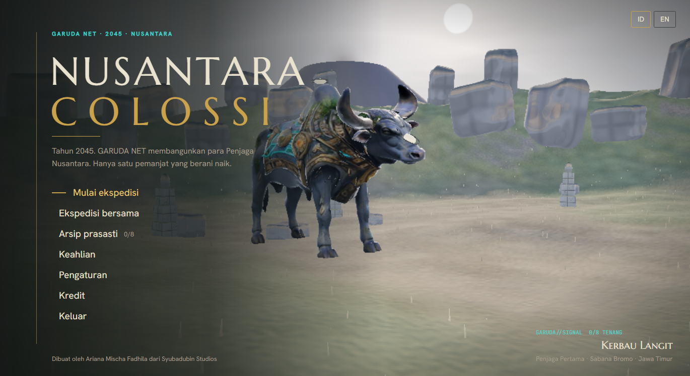 | 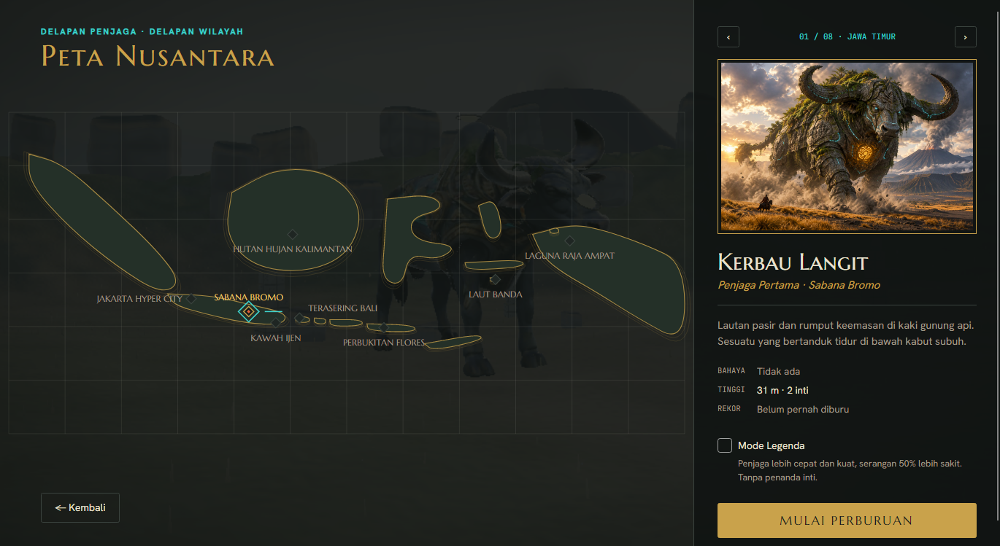 |
| 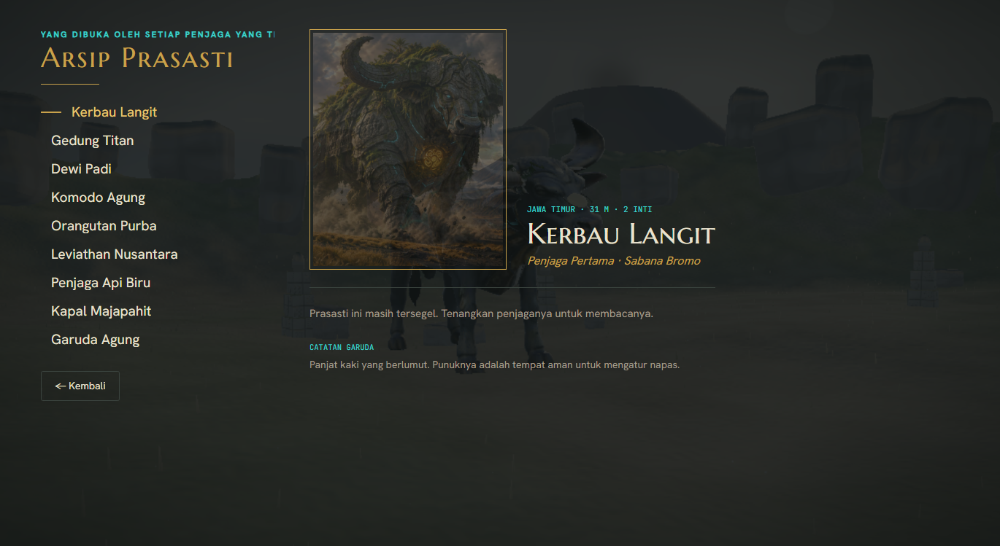 | 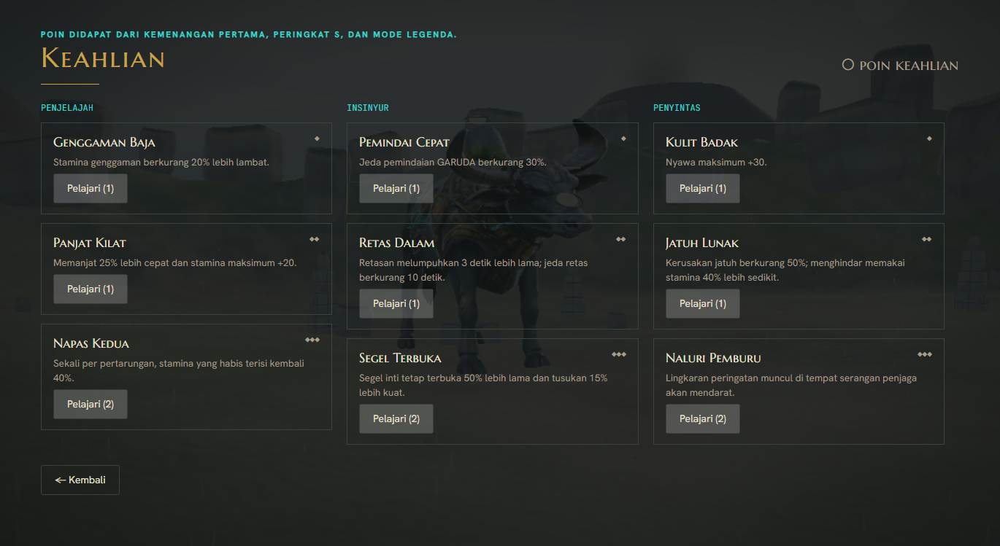 |

### Yang kamu lakukan

- **Memanjat raksasa hidup.** Setiap Penjaga adalah tubuh bersendi. Kamu bisa menggenggamnya, memanjatnya, berdiri di atasnya, dan berpindah antaranggota tubuhnya. Stamina genggaman terkuras saat bergantung. Penjaga akan berusaha mengguncangmu lepas, dan selalu ada peringatan sesaat sebelumnya.
- **Membaca detak jantung.** Setiap inti berdenyut. Tahan tusukan, lalu lepaskan tepat pada denyutnya untuk serangan **resonansi** dengan kerusakan ×1,5. Cincin kawung di HUD dan detak jantung di audio sama-sama menandai iramanya.
- **Bekerja sama dengan GARUDA.** **Pindai** untuk membuka segel kuno inti selama beberapa detik. **Retas** untuk melumpuhkan Penjaga mekanis dan membuka inti berpelat. **Pasang umpan hologram** untuk memancing Penjaga menjauh. Ketiganya terbuka seiring kemajuanmu.
- **Delapan wilayah, delapan Penjaga**, masing-masing dengan bahayanya sendiri:

  | Wilayah | Penjaga | Bahaya |
  |---|---|---|
  | Bromo | Kerbau Langit | — |
  | Jakarta | Gedung Titan | hujan di kaca |
  | Bali | Dewi Padi | — |
  | Flores | Komodo Agung | panas |
  | Kalimantan | Orangutan Purba | hujan |
  | Raja Ampat | Leviathan Nusantara | — |
  | Ijen | Penjaga Api Biru | gas belerang |
  | Laut Banda | Kapal Majapahit | hembusan badai |

- **Fase amukan, peringkat, dan Mode Legenda.** Penjaga makin cepat ketika melemah. Setiap perburuan mendapat peringkat S/A/B/C. Mode Legenda membuat Penjaga lebih cepat dan lebih kuat, tanpa penanda inti.
- **RPG ringan.** Tiga pohon keahlian (Penjelajah, Insinyur, Penyintas), masing-masing tiga tingkat. Poin didapat dari kemenangan pertama, peringkat S, dan Mode Legenda.
- **Co-op 2–4 pemain** lewat LAN atau IP langsung. Host menjalankan simulasi Penjaga, dan setiap pemburu memanjat dengan kendali lokalnya sendiri.
- **Dua bahasa penuh**: Bahasa Indonesia dan English, bisa diganti kapan saja.

### Unduh

Unduh build terbaru dari **[halaman Releases](https://github.com/SyubadubinStudios/Nusantara.Colossi/releases/latest)**. Versi 0.3.1:

| Platform | Berkas | Catatan |
|---|---|---|
| Windows 10/11 (x64) | [Installer (.exe)](https://github.com/SyubadubinStudios/Nusantara.Colossi/releases/download/v0.3.1/NusantaraColossi-0.3.1-win-x64-setup.exe) · [Portabel (.zip)](https://github.com/SyubadubinStudios/Nusantara.Colossi/releases/download/v0.3.1/NusantaraColossi-0.3.1-win-x64.zip) | Sudah diuji. Installer belum ditandatangani, jadi SmartScreen bisa memberi peringatan: pilih **More info → Run anyway**. |
| macOS (Apple Silicon) | [macos-arm64.zip](https://github.com/SyubadubinStudios/Nusantara.Colossi/releases/download/v0.3.1/NusantaraColossi-0.3.1-macos-arm64.zip) | Ekstrak, lalu klik kanan aplikasinya → **Open** (atau jalankan `xattr -dr com.apple.quarantine "Nusantara Colossi.app"`). Belum diuji di Mac sungguhan. |
| macOS (Intel) | [macos-x64.zip](https://github.com/SyubadubinStudios/Nusantara.Colossi/releases/download/v0.3.1/NusantaraColossi-0.3.1-macos-x64.zip) | Sama seperti di atas. |
| Linux (x86_64) | [AppImage](https://github.com/SyubadubinStudios/Nusantara.Colossi/releases/download/v0.3.1/NusantaraColossi-0.3.1-x86_64.AppImage) | `chmod +x NusantaraColossi-0.3.1-x86_64.AppImage`, lalu jalankan. Butuh Vulkan. Belum diuji di perangkat sungguhan. |
| Android 10+ (arm64) | [APK](https://github.com/SyubadubinStudios/Nusantara.Colossi/releases/download/v0.3.1/NusantaraColossi-0.3.1-android.apk) | Izinkan instalasi dari sumber tidak dikenal. **Eksperimental**: di tablet ber-GPU Mali-G51, v0.1.0 hanya sekitar 3 FPS; v0.2.0 menambah preset mobile yang lebih ringan, tetapi belum diukur di perangkat. Disarankan GPU kelas menengah ke atas. |

Semua build butuh GPU dengan DirectX 12, Vulkan, atau Metal. [Zip source-assets](https://github.com/SyubadubinStudios/Nusantara.Colossi/releases/download/v0.1.0/NusantaraColossi-0.1.0-source-assets.zip) (sekitar 470 MB) (dari v0.1.0, belum berubah) berisi berkas sumber Blender dan Rodin untuk modder; tidak diperlukan untuk bermain.

### Mulai cepat

Kebutuhan: .NET SDK 10.0.4xx dan GPU dengan DirectX 12, Vulkan, atau Metal.

```bash
dotnet run --project src/NusantaraColossi.Desktop -c Release
```

| Perintah | Fungsi |
|---|---|
| `dotnet build NusantaraColossi.slnx` | Build semua proyek, termasuk Android jika workload-nya terpasang |
| `dotnet test` | Jalankan semua tes: 82 tes simulasi plus 3 tes co-op lewat UDP loopback |
| `dotnet run --project tools/NusantaraColossi.AudioForge` | Buat ulang semua musik dan efek suara ke `assets/audio` |
| `dotnet run --project src/NusantaraColossi.Desktop -- --screenshot docs/images --lang id` | Ambil tangkapan layar untuk dokumentasi |
| `dotnet build src/NusantaraColossi.Android -c Release` | Build APK Android (butuh workload .NET Android) |

### Kontrol

| Aksi | Keyboard / mouse | Gamepad |
|---|---|---|
| Bergerak | WASD | Stik kiri |
| Kamera | Seret klik kanan atau tombol panah | Stik kanan |
| Genggam / panjat, lari | Tahan Shift | Tahan RT |
| Lompat | Spasi | A |
| Menghindar | Ctrl | B |
| Tusuk (tahan untuk mengisi) | Klik kiri / F | X |
| Kunci pandangan ke Penjaga | Tab | Y |
| Pindai · Retas · Umpan | Q · E · R | LB · RB · LT |
| Jeda | Esc | Start |

Di Android, separuh kiri layar berfungsi sebagai stik mengambang dan separuh kanan untuk memutar pandangan. Tombol jempol: Genggam, Tusuk, Lompat, Menghindar, dan tiga modul GARUDA.

### Dokumentasi

[Panduan pemain](docs/id/panduan-pemain.md) · [Desain game](docs/id/desain-game.md) · [Arsitektur](docs/id/arsitektur.md) · [Build & platform](docs/id/build.md) · [Pipeline aset & audio](docs/id/aset.md) · [Paket marketing](docs/marketing/README.md#bahasa-indonesia) · [PLAN.md](PLAN.md) · [Progress.md](Progress.md)
