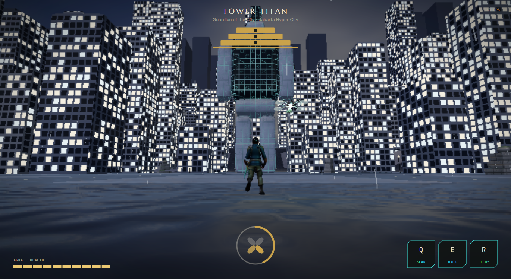

# Player guide

[Bahasa Indonesia](../id/panduan-pemain.md) · *Made by Ariana Mischa Fadhila of Syubadubin Studios*

## The hunt, step by step

1. **Pick a guardian on the Archipelago Map.** Regions open in order: beating a guardian opens the next region. The dossier on the right lists the region's hazard, the guardian's height and number of cores, and your record.
2. **Find a way up.** Look for climbable surfaces such as moss, fur, wood, coral, cloth and carved stone. Glass and polished obsidian can't be gripped. Stand next to a leg or tail and **hold Shift** (RT on a gamepad) to grip.
3. **Manage your grip.** The kawung ring at the bottom of the screen is your grip stamina. It drains while you hang and refills while you stand on a flat top surface, such as a back, shoulder or deck. It turns ember below 30%. Let go at zero and you fall.
4. **Scan the cores.** Every core starts sealed. Press **Q** (LB) and GARUDA opens every seal for several seconds. On the candi glyph at the top of the screen, a sealed tier has a dark notch and an open tier glows cyan.
5. **Strike on the beat.** Climb to a core and **hold left click** (X) to charge the stab. Near an open core, a dot in the ring beats with the core's pulse. Release the stab while the dot is bright for a **resonance** hit worth ×1.5 damage.
6. **Survive the rage.** At certain vitality thresholds a guardian enrages: it moves faster, its pulse quickens, and the score's rage layer comes in.

## The guardian fights back

| Warning | What it means | What to do |
|---|---|---|
| Rising rumble, "tremor!" in the log | A shake-off is coming | Hold your grip, or get onto a flat top surface |
| Charging growl, ground ring (with Hunter's Instinct) | Stomp windup | Dodge out of the ring (Ctrl / B) |
| Long roar | A roar shockwave expands | Get distance, or stay attached |
| "Gust incoming" (Banda Sea) | Storm wind in about 2 s | Hold your grip; standing climbers can be blown off |
| Green clouds (Ijen) | Sulfur gas | Stay out: it hurts and stops stamina recovery |

Falls hurt. Anything above a short drop costs health, and the **Soft Landing** skill reduces it.

## Signature mechanics

On top of the shared attacks, five guardians have a mechanic of their own:

| Guardian | Mechanic | How to survive |
|---|---|---|
| Dewi Padi | Every ~36 s the subak water floods the lower terraces. | Climb onto the high terraces or onto her body before GARUDA's warning runs out. Swimming drains stamina. |
| Gedung Titan | Glass panes fall from its tower body onto marked rings. | Keep moving when red rings appear. Climbers are safe. |
| Leviathan | Every ~30 s it dives about 9 m with you on its back. | A cyan **Breath** bar appears. Hold on for the dive, or let go and swim up before it empties. |
| Kapal Majapahit | Broadsides of cannonballs at anyone in the water or on the shoals. | Watch for the rings and swim or ride out of them. |
| Garuda Agung (secret) | Data bolts lock on to every hunter, climbers included. GARUDA cannot hack it. | Keep moving, even while climbing. Its wings are walkable runways to the wing-tip cores. |

## Vehicles and the GARUDA glider

- A **trail bike** (land arenas) or **jet ski** (sea arenas) is parked beside camp. Press **G** (D-pad up) next to it to ride, **G** again to get off. **Space** leaps off at speed, which is a fast way onto a guardian's leg.
- In the air, press **Space** or **G** to open the **GARUDA glider**. It sinks slowly, steers toward your stick, and costs a little stamina. Gliding landings never hurt.

## The ninth guardian

Defeat all eight guardians and a new signal appears on the map: **Nusantara Point Zero**. What waits there is the end of the story.

## Time board

Every guardian keeps a local board of your five fastest victories (solo or co-op, Legend marked). The victory card shows it and highlights a new record.

## GARUDA modules

| Module | Key | Unlocks | Effect |
|---|---|---|---|
| Scan | Q / LB | from the start | Opens every core seal for a time (shorter on some guardians) |
| Hack | E / RB | after the 1st guardian | Stuns the guardian and opens **plated** cores; works best on mechanical guardians |
| Decoy | R / LT | after the 2nd guardian | A hologram of Arka lures the guardian away |

## Ranks and points

Your rank (S, A, B or C) depends on time and damage taken. Skill points come from three sources:

- 2 points for a guardian's first defeat.
- +1 point the first time you earn an S rank on that guardian.
- +1 point for its first Legend-mode clear.

Spend them in **Skills**. Each tree has three tiers, and a tier opens when you learn the one below it.

| Tree | Tier 1 | Tier 2 | Tier 3 |
|---|---|---|---|
| Explorer | Iron Grip | Swift Climber | Second Wind |
| Engineer | Rapid Scan | Deep Hack | Open Seals |
| Survivalist | Rhino Hide | Soft Landing | Hunter's Instinct |

## Co-op

Open **Co-op expedition** and pick a role:

- **Host:** choose a guardian and press *Host expedition*. Your game starts immediately and other players can join mid-hunt.
- **Join:** enter the host's IP address and port (27045 by default), then press *Join*.

The host's machine simulates the guardian. Every player climbs with their own local controls, so climbing never lags. A fallen hunter returns to camp after 8 seconds. The host must allow inbound UDP on the chosen port in its firewall.

## Settings worth knowing

- **Graphics quality.** Low, Balanced or Cinematic. The game picks Low for integrated GPUs on first launch. A change applies after a restart.
- **Dynamic resolution.** Lowers the 3D resolution to hold your FPS cap during hunts.
- **Camera shake** and **Invert Y** are accessibility options. **Subtitles** caption GARUDA's voice.
