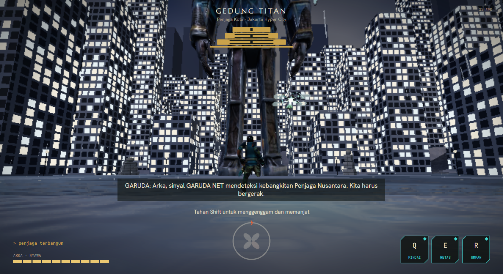

# Panduan pemain

[English](../en/player-guide.md) · *Dibuat oleh Ariana Mischa Fadhila dari Syubadubin Studios*

## Perburuan, langkah demi langkah

1. **Pilih Penjaga di Peta Nusantara.** Wilayah terbuka berurutan: menenangkan satu Penjaga membuka wilayah berikutnya. Panel di kanan menampilkan bahaya wilayah, tinggi Penjaga, jumlah inti, dan rekormu.
2. **Cari jalan naik.** Cari permukaan yang bisa dipanjat, seperti lumut, bulu, kayu, karang, kain, dan batu berukir. Kaca dan obsidian licin tidak bisa digenggam. Berdirilah di dekat kaki atau ekor, lalu **tahan Shift** (RT di gamepad) untuk menggenggam.
3. **Jaga genggamanmu.** Cincin kawung di bawah layar adalah stamina genggaman. Stamina terkuras saat bergantung dan pulih saat berdiri di permukaan atas yang datar, seperti punggung, bahu, atau dek. Cincin menjadi merah bara di bawah 30%. Jika stamina habis, kamu terlepas dan jatuh.
4. **Pindai inti.** Semua inti awalnya tersegel. Tekan **Q** (LB), dan GARUDA membuka semua segel selama beberapa detik. Pada glif candi di atas layar, tingkat yang tersegel bertakik gelap dan tingkat yang terbuka bersinar biru nadi.
5. **Tusuk tepat pada denyut.** Panjat ke inti dan **tahan klik kiri** (X) untuk mengisi tusukan. Di dekat inti yang terbuka, sebuah titik di cincin berdenyut mengikuti inti. Lepaskan tusukan saat titik itu terang untuk serangan **resonansi** dengan kerusakan ×1,5.
6. **Bertahan dari amukan.** Pada ambang vitalitas tertentu, Penjaga mengamuk: geraknya lebih cepat, denyutnya memburu, dan lapisan musik amukan masuk.

## Penjaga melawan balik

| Tanda | Artinya | Yang harus dilakukan |
|---|---|---|
| Gemuruh naik, "getaran!" di log | Guncangan akan datang | Tahan genggaman, atau naik ke permukaan atas yang datar |
| Geraman mengisi, cincin di tanah (dengan Naluri Pemburu) | Ancang-ancang injakan | Menghindar keluar cincin (Ctrl / B) |
| Raungan panjang | Gelombang kejut raungan menyebar | Ambil jarak, atau tetap menempel |
| "Hembusan angin dalam 2 dtk" (Laut Banda) | Angin badai | Tahan genggaman; pemanjat yang berdiri bisa terlempar |
| Awan hijau (Ijen) | Gas belerang | Hindari: melukai dan menghentikan pemulihan stamina |

Jatuh itu sakit. Jatuh lebih dari sedikit saja akan mengurangi nyawa, dan keahlian **Jatuh Lunak** menguranginya.

## Mode foto

Jeda perburuan solo dan pilih **Mode foto**. HUD disembunyikan dan kamera bebas melayang dalam radius 40 m: **WASD** menggeser, mouse atau stik kanan untuk melihat, **Q/E** turun dan naik, **Z/X** zoom. **Enter** atau **Spasi** menyimpan PNG ke `Pictures/Nusantara Colossi`. **Esc** kembali ke menu jeda.

## Mekanik khas

Selain serangan bersama, lima Penjaga punya mekanik sendiri:

| Penjaga | Mekanik | Cara bertahan |
|---|---|---|
| Dewi Padi | Sekitar tiap 36 detik air subak membanjiri teras bawah. | Naik ke teras tinggi atau ke tubuhnya sebelum peringatan GARUDA habis. Berenang menguras stamina. |
| Gedung Titan | Panel kaca berjatuhan dari tubuh menaranya ke lingkaran bertanda. | Terus bergerak saat lingkaran merah muncul. Pemanjat aman. |
| Leviathan | Sekitar tiap 30 detik ia menyelam kira-kira 9 m bersama kamu di punggungnya. | Bilah **Napas** biru muncul. Bertahan selama penyelaman, atau lepas dan berenang naik sebelum habis. |
| Kapal Majapahit | Tembakan meriam lambung ke siapa pun di air atau di beting. | Perhatikan lingkaran dan berenang atau berkendara keluar darinya. |
| Garuda Agung (rahasia) | Petir data mengunci setiap pemburu, termasuk yang memanjat. GARUDA tidak bisa meretasnya. | Terus bergerak, bahkan saat memanjat. Sayapnya adalah landasan yang bisa dipijak menuju inti di ujung sayap. |

## Kendaraan dan sayap GARUDA

- **Motor trail** (arena darat) atau **jet ski** (arena laut) diparkir di samping perkemahan. Tekan **G** (D-pad atas) di dekatnya untuk naik, **G** lagi untuk turun. **Spasi** melompat dari kendaraan yang melaju, cara cepat menuju kaki Penjaga.
- Di udara, tekan **Spasi** atau **G** untuk membuka **sayap GARUDA**. Turunnya pelan, arahnya mengikuti stik, dan memakai sedikit stamina. Mendarat sambil melayang tidak pernah melukai.

## Penjaga kesembilan

Kalahkan kedelapan Penjaga dan sebuah sinyal baru muncul di peta: **Titik Nol Nusantara**. Yang menunggu di sana adalah akhir cerita.

## Papan waktu

Setiap Penjaga menyimpan papan lokal berisi lima kemenangan tercepatmu (solo atau co-op, mode Legenda ditandai). Kartu kemenangan menampilkannya dan menyorot rekor baru.

## Modul GARUDA

| Modul | Tombol | Terbuka | Efek |
|---|---|---|---|
| Pindai | Q / LB | sejak awal | Membuka semua segel inti untuk sementara (lebih singkat pada Penjaga tertentu) |
| Retas | E / RB | setelah Penjaga ke-1 | Melumpuhkan Penjaga dan membuka inti **berpelat**; paling ampuh pada Penjaga mekanis |
| Umpan | R / LT | setelah Penjaga ke-2 | Hologram Arka memancing Penjaga menjauh |

## Peringkat dan poin

Peringkat (S, A, B, atau C) bergantung pada waktu dan luka yang diterima. Poin keahlian datang dari tiga sumber:

- 2 poin saat sebuah Penjaga pertama kali dikalahkan.
- +1 poin saat pertama kali mendapat peringkat S pada Penjaga itu.
- +1 poin saat pertama kali menamatkannya di Mode Legenda.

Belanjakan poin di menu **Keahlian**. Setiap pohon punya tiga tingkat, dan satu tingkat terbuka setelah tingkat di bawahnya dipelajari.

| Pohon | Tingkat 1 | Tingkat 2 | Tingkat 3 |
|---|---|---|---|
| Penjelajah | Genggaman Baja | Panjat Kilat | Napas Kedua |
| Insinyur | Pemindai Cepat | Retas Dalam | Segel Terbuka |
| Penyintas | Kulit Badak | Jatuh Lunak | Naluri Pemburu |

## Co-op

Buka **Ekspedisi bersama**, lalu pilih peran:

- **Host:** pilih Penjaga dan tekan *Buka ekspedisi*. Permainanmu langsung dimulai, dan pemain lain bisa bergabung di tengah perburuan.
- **Bergabung:** isi alamat IP host dan port (bawaan 27045), lalu tekan *Gabung*.

Komputer host menjalankan simulasi Penjaga. Setiap pemain memanjat dengan kendali lokalnya sendiri, jadi memanjat tidak pernah lag. Pemburu yang tumbang kembali ke perkemahan setelah 8 detik. Host harus membuka port UDP yang dipilih di firewall.

## Pengaturan yang perlu diketahui

- **Kualitas grafis.** Hemat, Seimbang, atau Sinematik. Game memilih Hemat untuk GPU terintegrasi saat pertama kali dijalankan. Perubahan berlaku setelah game dimulai ulang.
- **Resolusi dinamis.** Menurunkan resolusi 3D agar batas FPS tetap tercapai saat berburu.
- **Guncangan kamera** dan **Balik sumbu Y** adalah opsi aksesibilitas. **Subtitle** menampilkan teks suara GARUDA.
