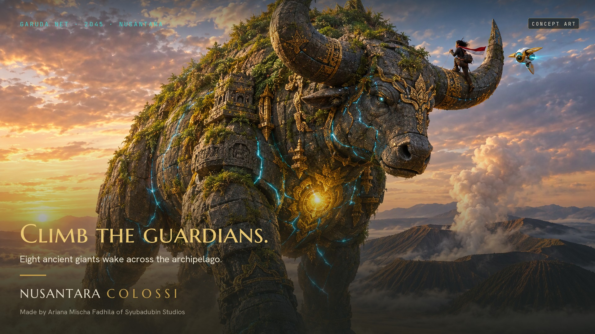
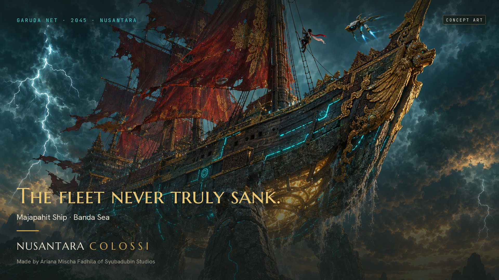

# Nusantara Colossi: marketing kit

**English** · [Bahasa Indonesia](#bahasa-indonesia)

> *Dibuat oleh Ariana Mischa Fadhila dari Syubadubin Studios*
> *Made by Ariana Mischa Fadhila of Syubadubin Studios*

Social-media posts for the game: ready-to-upload images in Indonesian and English, captions per platform, and a two-week posting plan.

| | |
|---|---|
|  |  |

## What is here

| Path | Contents |
|---|---|
| [`posts-en.md`](posts-en.md) | English captions for Instagram, X, Facebook, TikTok/Reels and LinkedIn |
| [`posts-id.md`](posts-id.md) | The same posts in Bahasa Indonesia |
| `posts/en/`, `posts/id/` | 12 images per language (JPEG) |
| `art/` | Uncropped 2D concept art from Rodin (GPT Image Flare), with no text |
| [`compose_posts.py`](compose_posts.py) | Rebuilds every post from `art/` and `docs/images/` (`python docs/marketing/compose_posts.py`, needs Pillow) |

### Images

| # | Post | Formats | Source |
|---|---|---|---|
| 01 | Key art: Sky Buffalo, Bromo | 16:9, 4:5 | concept art |
| 02 | Tower Titan, Jakarta | 4:5 | concept art |
| 03 | Blue Fire Warden, Ijen | 9:16, 4:5 | concept art |
| 04 | Majapahit Ship, Banda Sea | 16:9, 4:5 | concept art |
| 05 | Arka & GARUDA | 4:5, 9:16 | concept art |
| 06 | Co-op on the Leviathan, Raja Ampat | 4:5, 1:1 | concept art |
| 07 | Straight from the game | 16:9 | in-game screenshot |

Sizes: 16:9 is 1920×1080 (X, YouTube, Facebook). 4:5 is 1080×1350 (Instagram feed). 9:16 is 1080×1920 (Stories, Reels, TikTok). 1:1 is 1080×1080. The in-game post keeps the screenshot's own width (1370 px), so it is never upscaled.

## Rules for using these images

- **Label concept art.** The Rodin images are far more detailed than the game's current graphics. Every concept-art post carries a "CONCEPT ART" tag. Keep the tag, and never caption these images as gameplay.
- **Pair art with gameplay.** Post 07 is a real screenshot. Post it early, and add more real screenshots or clips as the game improves.
- **Always include the credit line**: *Dibuat oleh Ariana Mischa Fadhila dari Syubadubin Studios* (EN: *Made by Ariana Mischa Fadhila of Syubadubin Studios*). It is already on every image.
- **Only claim what ships.** Windows, macOS, Linux and Android builds exist. Android has only been tested on one low-end tablet, and it was not playable there (see [Progress.md](../../Progress.md)). Do not promise smooth mobile play yet.
- **Brand colors**: andesite `#161B19`, prada gold `#C9A24B` / `#EBC872`, nadi cyan `#3FD6CF`, kapur `#E9E2CF`.
- **Fonts**: Marcellus SC for titles, Hanken Grotesk for body text, JetBrains Mono for labels. All use the SIL Open Font License.

## Two-week plan

| Day | Post | Platforms |
|---|---|---|
| 1 | 01 key art (announcement) | all |
| 2 | 07 in-game screenshot | X, Facebook, LinkedIn |
| 4 | 05 Arka & GARUDA | Instagram feed + story |
| 6 | 02 Tower Titan | Instagram, X |
| 8 | 03 Blue Fire Warden | Stories, TikTok/Reels (vertical) |
| 10 | 06 co-op | all |
| 12 | 04 Majapahit Ship | all |
| 14 | Recap carousel (01→06, ending on 07) + download link | Instagram, Facebook |

Download link: <https://github.com/SyubadubinStudios/Nusantara.Colossi/releases/latest>

---

## Bahasa Indonesia

Paket konten media sosial untuk game ini: gambar siap unggah dalam bahasa Indonesia dan Inggris, caption per platform, dan rencana posting dua minggu.

### Isi folder

| Lokasi | Isi |
|---|---|
| [`posts-id.md`](posts-id.md) | Caption bahasa Indonesia untuk Instagram, X, Facebook, TikTok/Reels, dan LinkedIn |
| [`posts-en.md`](posts-en.md) | Post yang sama dalam bahasa Inggris |
| `posts/id/`, `posts/en/` | 12 gambar per bahasa (JPEG) |
| `art/` | Concept art 2D utuh dari Rodin (GPT Image Flare), tanpa teks |
| [`compose_posts.py`](compose_posts.py) | Membuat ulang semua post dari `art/` dan `docs/images/` (`python docs/marketing/compose_posts.py`, butuh Pillow) |

### Aturan pemakaian gambar

- **Beri label pada concept art.** Gambar Rodin jauh lebih detail daripada grafis game saat ini. Setiap post concept art memuat label "CONCEPT ART". Jangan hapus labelnya, dan jangan menyebut gambar itu sebagai gameplay.
- **Seimbangkan dengan gameplay asli.** Post 07 adalah tangkapan layar asli. Unggah lebih awal, lalu tambahkan screenshot atau klip asli seiring game berkembang.
- **Selalu cantumkan kredit**: *Dibuat oleh Ariana Mischa Fadhila dari Syubadubin Studios*. Kredit ini sudah ada di setiap gambar.
- **Klaim hanya yang sudah ada.** Build Windows, macOS, Linux, dan Android sudah tersedia. Android baru diuji di satu tablet kelas bawah dan belum bisa dimainkan dengan lancar di sana (lihat [Progress.md](../../Progress.md)). Jangan menjanjikan permainan mobile yang mulus dulu.
- **Warna**: andesit `#161B19`, emas prada `#C9A24B` / `#EBC872`, sian nadi `#3FD6CF`, kapur `#E9E2CF`.

### Rencana dua minggu

| Hari | Post | Platform |
|---|---|---|
| 1 | 01 key art (pengumuman) | semua |
| 2 | 07 tangkapan layar game | X, Facebook, LinkedIn |
| 4 | 05 Arka & GARUDA | feed + story Instagram |
| 6 | 02 Gedung Titan | Instagram, X |
| 8 | 03 Penjaga Api Biru | Story, TikTok/Reels (vertikal) |
| 10 | 06 co-op | semua |
| 12 | 04 Kapal Majapahit | semua |
| 14 | Carousel rangkuman (01→06, ditutup 07) + tautan unduh | Instagram, Facebook |

Tautan unduh: <https://github.com/SyubadubinStudios/Nusantara.Colossi/releases/latest>
